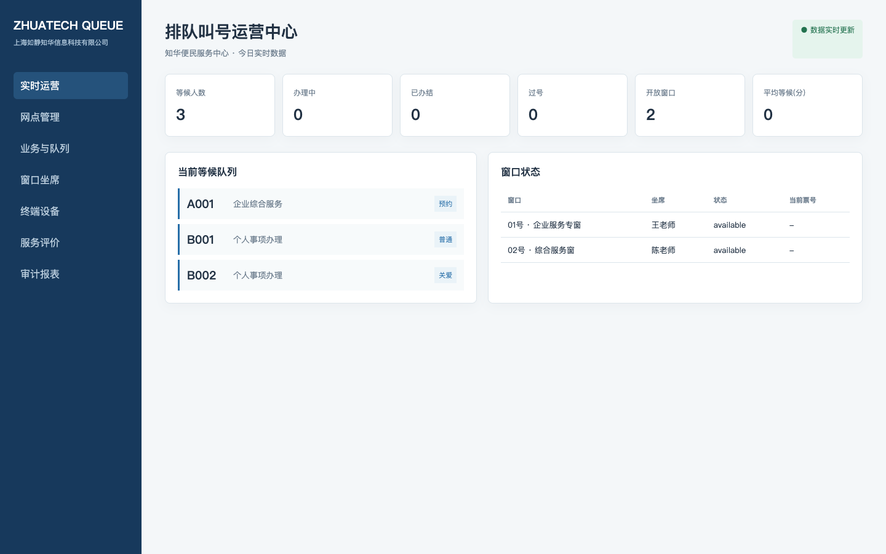
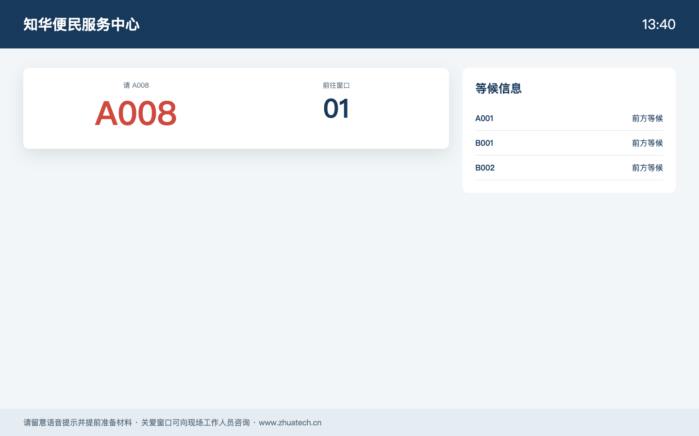

# 知华排队叫号与窗口服务平台

`zhuatech-queue-terminal` 适用于政务大厅、医院、银行、客服中心与园区服务台，实现网点、业务类型、取号机、叫号屏、窗口坐席、优先队列、重呼转派、过号办结和服务指标闭环。系统使用可测试的领域状态机，不是只有叫号大屏的页面模板。

由[知华科技（上海如静知华信息科技有限公司）](https://www.zhuatech.cn/)维护。排队终端适配、国产化部署、窗口服务数字化、商业授权或定制开发，请微信添加 `zhuatech` 或 `zhuatech2`。

| 运营中心 | 公共叫号信息屏 |
| --- | --- |
|  |  |

## 一次完整办理

```text
选择业务 → 取号/预约核验 → 关爱/预约/普通队列排序 → 窗口叫号
→ 重呼/转派 → 办结或过号 → 窗口释放 → 运营分析与审计
```

## 功能矩阵

- 网点、营业时间、暂停取号与多终端注册；
- 业务票号前缀、服务 SLA、窗口受理范围与坐席；
- 每日连续票号、手机号脱敏、关爱/预约优先级；
- 叫号、最多三次重呼、跨窗口转派、过号和办结；
- 实时等候、平均等待、窗口开放、办结与过号指标；
- API Key、终端令牌入口、审计日志、JSON 快照和 MySQL 8 模型。

## 本地运行

```bash
cp .env.example .env
npm test
QUEUE_API_KEY=zhuatech-demo-key npm start
```

运营端 `http://127.0.0.1:18202/`，叫号屏 `http://127.0.0.1:18202/display`，健康检查 `/health`。也可执行 `docker compose up --build`。

演示密钥仅用于本地体验。生产环境必须启用 TLS、坐席身份认证、终端证书、数据库事务、号码隐私保护以及屏幕/音响设备离线告警。

## 许可与商务

本项目仅限个人非商业学习、研究和交流，**不得商用**。企业内部使用、私有部署、SaaS、投标、交付或收费服务须取得上海如静知华信息科技有限公司书面授权。本项目不是 OSI 定义的开源许可证项目。

| 微信号 `zhuatech` | 微信号 `zhuatech2` |
| --- | --- |
|  |  |

Copyright © 上海如静知华信息科技有限公司。
